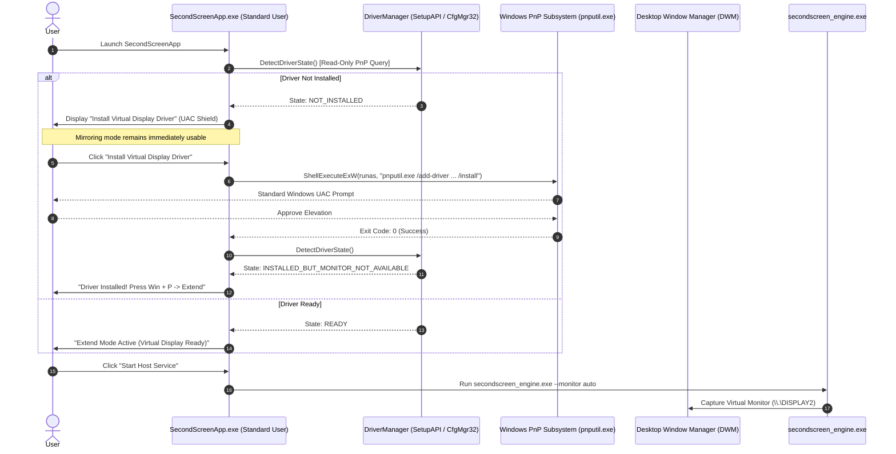

# Automatic First-Launch Driver Installation & Lifecycle Management

## 1. Architectural Overview

SecondScreen now integrates **automatic driver detection, first-launch setup guidance, and privileged lifecycle management** directly within the native Windows desktop application ([`SecondScreenApp.exe`](file:///d:/Second%20Display/native/windows_engine/src/app/main_window.cpp)), removing the requirement for users to manually locate and execute shell scripts.



---

## 2. Authoritative Driver Lifecycle States

The dedicated [`DriverManager`](file:///d:/Second%20Display/native/windows_engine/include/driver/driver_manager.hpp) evaluates the exact status of `Root\SecondScreenIdd` within `GUID_DEVCLASS_DISPLAY`:

| State | Evaluation Logic | Application Behavior |
| :--- | :--- | :--- |
| `NOT_INSTALLED` | No PnP device with Hardware ID matching `Root\SecondScreenIdd` found in `Class = Display`. | Prompts user with "Install Virtual Display Driver" (UAC Shield). Desktop mirroring remains fully functional. |
| `INSTALLED_BUT_NOT_OPERATIONAL` | Device node found, but `CM_Get_DevNode_Status` returns `DN_HAS_PROBLEM` or missing `DN_STARTED`. | Shows warning badge with device error code. Offers "Repair / Reinstall Driver" action. |
| `INSTALLED_BUT_MONITOR_NOT_AVAILABLE` | Driver is started and healthy, but desktop display mode is set to Duplicate or Single Monitor. | Guides user: *"Driver Active: Press Win + P and choose 'Extend' to activate virtual screen."* |
| `READY` | Driver started and multiple monitors active in Windows desktop system (`SM_CMONITORS > 1`). | Green badge: *"● Extend Mode Active (Virtual Display Ready)"*. Streaming engine auto-captures extended monitor. |
| `INSTALLATION_IN_PROGRESS` | Privileged installer is executing. | Progress logged to diagnostic console; duplicate install triggers disabled. |
| `RESTART_REQUIRED` | Installer returns exit code `3010` (`ERROR_SUCCESS_REBOOT_REQUIRED`). | Informs user that a system restart is required before Windows initializes the driver host. |
| `INSTALLATION_FAILED` | `pnputil` exited with non-zero error or UAC was declined. | Actionable error displayed in log; retry button available; app stays in safe mirroring mode. |
| `UNSUPPORTED_OR_BLOCKED` | Host OS is older than Windows 10 Version 1809 (Build 17763) or blocked by group policy. | Informs user that Extended Display requires Windows 10/11; keeps desktop mirroring active. |

---

## 3. Files Created & Modified

### New Components
1. [`native/windows_engine/include/driver/driver_manager.hpp`](file:///d:/Second%20Display/native/windows_engine/include/driver/driver_manager.hpp): C++ header declaring `DriverState`, `DriverInfo`, and `DriverManager`.
2. [`native/windows_engine/src/driver/driver_manager.cpp`](file:///d:/Second%20Display/native/windows_engine/src/driver/driver_manager.cpp): Implementation querying `SetupDiGetClassDevsW`, `SetupDiEnumDeviceInfo`, `CM_Get_DevNode_Status`, `RtlGetVersion`, and privileged execution via `ShellExecuteExW` (`runas`).
3. [`native/windows_engine/tests/test_driver_manager.cpp`](file:///d:/Second%20Display/native/windows_engine/tests/test_driver_manager.cpp): Automated unit test suite verifying state detection, mock state transitions, OS compatibility, and INF path resolution.
4. [`docs/driver-installation-audit.md`](file:///d:/Second%20Display/docs/driver-installation-audit.md): Complete audit of pre-existing components and gap analysis.
5. [`docs/automatic-driver-installation.md`](file:///d:/Second%20Display/docs/automatic-driver-installation.md): Architectural guide and verification report.

### Modified Components
1. [`native/windows_engine/src/app/main_window.cpp`](file:///d:/Second%20Display/native/windows_engine/src/app/main_window.cpp):
   - Added `g_driverMgr` lifecycle integration.
   - Added `IDC_BTN_INSTALL_DRIVER` with Windows UAC Shield icon (`BCM_SETSHIELD`).
   - Added `IDC_BTN_UNINSTALL_DRIVER` with confirmation safeguard.
   - Dynamic 3-second polling on `WM_TIMER` to automatically reflect display topology changes without requiring manual refresh.
   - Real-time driver status text and instructions in `WM_PAINT`.
2. [`native/windows_engine/CMakeLists.txt`](file:///d:/Second%20Display/native/windows_engine/CMakeLists.txt):
   - Added `src/driver/driver_manager.cpp` to `secondscreen_protocol`.
   - Linked `setupapi`, `cfgmgr32`, and `shlwapi`.
   - Added `secondscreen_driver_tests` test executable and test target.

---

## 4. Security & Elevation Architecture

1. **Standard User Privilege by Default**:
   `SecondScreenApp.exe` does **not** require elevation to launch or monitor status. It runs under standard user credentials (`asInvoker`). All PnP device enumeration (`SetupDiGetClassDevsW`) and Configuration Manager status checks (`CM_Get_DevNode_Status`) are non-privileged read operations.
2. **Explicit User-Initiated Elevation**:
   Elevation is only requested when the user clicks the **🛡️ Install Virtual Display Driver** or **Uninstall Driver** button. The application uses `ShellExecuteExW` with the `runas` verb to invoke `pnputil.exe`.
3. **User Cancellation Handling**:
   If the user selects "No" on the Windows UAC dialog, `ShellExecuteExW` catches `ERROR_CANCELLED` (1223) cleanly and logs:
   `[WARN] Driver installation was canceled by the user (UAC declined).`
   The application continues operating normally in desktop mirroring mode without crashing.
4. **Deliberate Uninstallation Safeguard**:
   Clicking "Uninstall Driver" requires explicit two-button confirmation (`MB_YESNO`) before executing elevated device teardown.

---

## 5. Test-Signing vs. Production WHQL Signing

* **Development & Self-Built Packages**:
  Because the driver is self-compiled, Windows requires **Test-Signing Mode** to load unsigned or self-signed driver binaries:
  ```cmd
  bcdedit /set testsigning on
  ```
* **Production Deployment**:
  In a production release, the driver package (`SecondScreenIdd.cat`) must be submitted to Microsoft Hardware Dev Center for Windows Hardware Quality Labs (WHQL) attestation signing. Once WHQL signed, the driver installs seamlessly on standard Windows machines without enabling test-signing.

---

## 6. Verification & Test Results

### 1. Driver Manager Automated Unit Tests
* **Executable**: `native/windows_engine/build/secondscreen_driver_tests.exe`
* **Result**: **PASS** (6 / 6 tests passed)
  - `TestStateToString`: **PASS**
  - `TestStateDescription`: **PASS**
  - `TestIsIddCxSupportedOnCurrentOS`: **PASS** (Identified host Windows 11 Build 26200 as supported)
  - `TestDetectDriverStateDefault`: **PASS** (Authoritatively detected `NOT_INSTALLED`)
  - `TestMockStateLifecycle`: **PASS** (Verified all 8 lifecycle states)
  - `TestFindDriverInfPath`: **PASS** (Resolved `d:\Second Display\native\virtual_display_driver\SecondScreenIdd.inf`)

### 2. Native Windows Engine Protocol Tests
* **Executable**: `native/windows_engine/build/secondscreen_protocol_tests.exe`
* **Result**: **PASS** (19 / 19 tests passed)

### 3. Android Client Test Suite
* **Command**: `flutter test` (in `apps/android_app`)
* **Result**: **PASS** (62 / 62 tests passed, 0 failures, elapsed time 16s)

---

## 7. Operational Status on Current Machine

| Capability | Current Status | Notes |
| :--- | :--- | :--- |
| **Driver Detection** | **OPERATIONAL** | Queries Windows PnP subsystem; correctly reports `NOT_INSTALLED`. |
| **First-Launch Setup UI** | **OPERATIONAL** | Prompts user with "Install Driver" button featuring the Windows UAC shield. |
| **Desktop Mirroring Fallback** | **OPERATIONAL** | Desktop streaming, touch injection, cursor compositing, and QR pairing work immediately without driver. |
| **Elevated Installer Dispatch** | **OPERATIONAL** | Invokes `pnputil.exe` via `runas` with parameter validation and exit code tracking. |
| **Driver Binary Compilation** | **PREREQUISITE DEPENDENCY** | Compiling `SecondScreenIdd.dll` requires Visual Studio 2022 with MSVC v143 and WDK 11 (Windows Driver Kit). |

