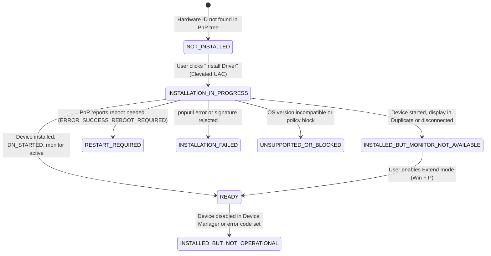
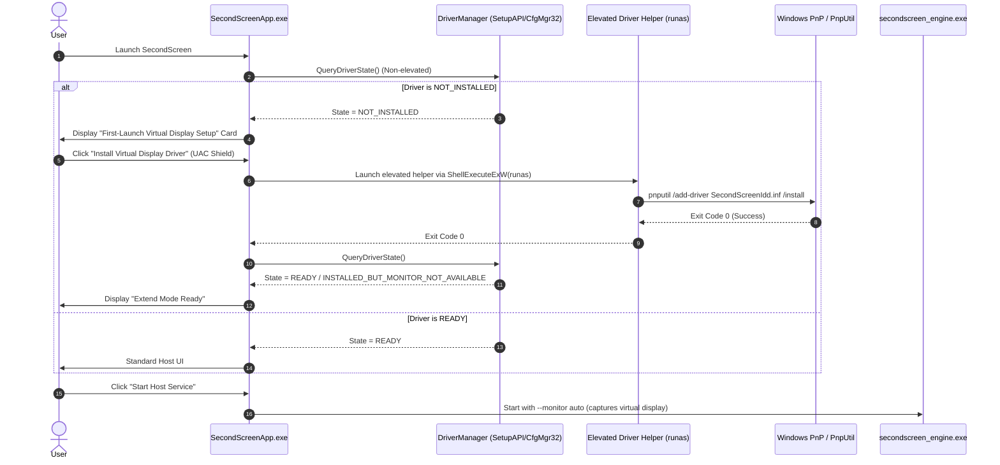

# SecondScreen Driver Installation & Lifecycle Audit

**Audit Date:** 2026-10-31  
**Target Architecture:** Windows Indirect Display Driver (IddCx / UMDF 2.x)  
**Host Application:** Native Win32 C++ Desktop Host (`SecondScreenApp.exe`)  
**Engine:** `secondscreen_engine.exe` (DXGI Desktop Duplication + Media Foundation H.264)

---

## 1. Executive Summary

SecondScreen requires an independent virtual monitor for true Windows **Extend mode** (`Win + P` $\to$ Extend), separating the streaming client's view from the physical PC monitor.

This audit reviews:
1. The desktop application UI and framework.
2. The current IddCx virtual display driver implementation.
3. Driver packaging, signing, and installation mechanisms.
4. Existing driver detection and monitor enumeration logic.
5. Missing components required for automatic first-launch installation and lifecycle management.

---

## 2. Component-by-Component Audit

### 2.1 Windows Desktop Application Entry Point & UI Framework
* **Location:** [`native/windows_engine/src/app/main_window.cpp`](file:///d:/Second%20Display/native/windows_engine/src/app/main_window.cpp)
* **Framework:** Pure Win32 API (`user32.dll`, `gdi32.dll`, `dwmapi.dll`, `comctl32.dll`). No heavy frameworks (MFC/Qt/Electron/WPF).
* **Current Status:**
  - Provides a high-performance native window with Slate dark theme styling.
  - Controls engine process lifecycle via [`ProcessManager`](file:///d:/Second%20Display/native/windows_engine/src/app/process_manager.cpp).
  - Generates QR pairing codes and exports companion HTML.
  - Houses expandable diagnostic logs.
  - **Limitation:** Displays static buttons for "Display Settings" and "Driver Guide", but lacks integrated first-launch driver detection, an installation progress dialog/banner, and automated privileged installation execution.

### 2.2 Virtual Display Driver Implementation
* **Location:** [`native/virtual_display_driver/`](file:///d:/Second%20Display/native/virtual_display_driver/)
* **Files:**
  - [`Driver.h`](file:///d:/Second%20Display/native/virtual_display_driver/Driver.h) / [`Driver.cpp`](file:///d:/Second%20Display/native/virtual_display_driver/Driver.cpp): Implements `DriverEntry` and `EvtDriverDeviceAdd` using `IddCxDeviceInitConfig`.
  - [`Device.h`](file:///d:/Second%20Display/native/virtual_display_driver/Device.h) / [`Device.cpp`](file:///d:/Second%20Display/native/virtual_display_driver/Device.cpp): Implements `EvtDeviceD0Entry`/`Exit`, `IddCxAdapterInitAsync`, and monitor arrival triggers.
  - [`Monitor.h`](file:///d:/Second%20Display/native/virtual_display_driver/Monitor.h) / [`Monitor.cpp`](file:///d:/Second%20Display/native/virtual_display_driver/Monitor.cpp): Generates CEA-861 compliant EDID declaring `"SCS"` monitor ID with baseline 1280x720 @ 60Hz and secondary 1920x1080 @ 60Hz modes, implementing `IddCxMonitorArrival` and swapchain worker loops.
  - [`Trace.h`](file:///d:/Second%20Display/native/virtual_display_driver/Trace.h): WPP tracing definitions.
* **Architecture:** Supported Microsoft UMDF 2.x User-Mode Driver Framework on top of IddCx 1.4+.
* **Status:** Complete source implementation adhering to Microsoft Indirect Display Driver architecture.

### 2.3 Driver INF, Packaging & Build Configuration
* **INF Package:** [`native/virtual_display_driver/SecondScreenIdd.inf`](file:///d:/Second%20Display/native/virtual_display_driver/SecondScreenIdd.inf)
  - Device Class: `Display` (`GUID {4d36e968-e325-11ce-bfc1-08002be10318}`)
  - Hardware ID: `Root\SecondScreenIdd`
  - Service: `WUDFHost.exe` with `WUDFRd.sys` reflector
* **Project File:** [`SecondScreenIdd.vcxproj`](file:///d:/Second%20Display/native/virtual_display_driver/SecondScreenIdd.vcxproj) configured for Visual Studio 2022 + WDK 11.
* **Current Status & Missing Binaries:**
  - The driver binary (`SecondScreenIdd.dll`), security catalog (`SecondScreenIdd.cat`), and certificate (`SecondScreenIdd.cer`) require MSVC v143 and WDK 11 to compile.
  - On development environments lacking the proprietary WDK 11 compiler, binary generation cannot be performed locally without provisioning VS 2022 + WDK 11.
  - Packaging must support pre-built signed driver packages or graceful detection of development environments.

### 2.4 Existing Driver Installation Scripts
* **Location:** [`native/virtual_display_driver/scripts/install_driver.bat`](file:///d:/Second%20Display/native/virtual_display_driver/scripts/install_driver.bat) and [`uninstall_driver.bat`](file:///d:/Second%20Display/native/virtual_display_driver/scripts/uninstall_driver.bat).
* **Mechanism:** Checks `net session` for elevation and executes `pnputil /add-driver SecondScreenIdd.inf /install`.
* **Limitation:** Requires the user to leave the application, locate the script in File Explorer, and manually run as Administrator. No programmatic feedback or state integration is reported to `SecondScreenApp.exe`.

### 2.5 Current Driver Detection & Display Enumeration
* **Engine Duplication:** [`native/windows_engine/src/capture/dxgi_capturer.cpp`](file:///d:/Second%20Display/native/windows_engine/src/capture/dxgi_capturer.cpp)
  - `DxgiCapturer::EnumerateOutputs()` iterates DXGI adapters and outputs, identifying monitors attached to the desktop.
  - Automatically selects extended/virtual monitor (`\\.\DISPLAY2`) when multiple outputs are present.
  - Translates touch coordinates accurately based on `DesktopCoordinates.left` and `DesktopCoordinates.top`.
* **Application State Check:**
  - In `main_window.cpp`, driver presence is inferred solely through `GetSystemMetrics(SM_CMONITORS)`.
  - **Limitation:** Inadequate. `SM_CMONITORS > 1` only indicates that *some* secondary monitor exists (such as a physical HDMI/DisplayPort monitor), not whether the SecondScreen driver specifically is installed, started, failed, or awaiting a restart.

---

## 3. Authoritative Driver Lifecycle States

To eliminate guesswork, a dedicated driver manager must query the Windows PnP subsystem using `SetupDiGetClassDevsW`, `SetupDiEnumDeviceInfo`, and `CM_Get_DevNode_Status` to evaluate the exact state of `Root\SecondScreenIdd`:

| Driver State | Description | Application Behavior |
| :--- | :--- | :--- |
| `NOT_INSTALLED` | No PnP device matching `Root\SecondScreenIdd` exists in `Class = Display`. | Prompt first-time user with "Install Driver" setup card. Mirroring remains active. |
| `INSTALLED_BUT_NOT_OPERATIONAL` | Device exists in PnP tree, but `DN_STARTED` is missing (device disabled or code 10/43). | Offer "Repair / Enable Driver" action; show device error code. |
| `INSTALLED_BUT_MONITOR_NOT_AVAILABLE` | Driver is started and healthy, but desktop is in Duplicate mode or monitor is detached. | Instruct user to press `Win + P` $\to$ Extend. Provide one-click shortcut to Display Settings. |
| `READY` | Driver is running (`DN_STARTED`) and virtual display is enumerated in DXGI output list. | Full Extended Display streaming active. Auto-selects virtual display. |
| `INSTALLATION_IN_PROGRESS` | Privileged installer is running. | Show spinner/progress and disable duplicate elevation triggers. |
| `RESTART_REQUIRED` | Installation returned reboot code (3010 / `ERROR_SUCCESS_REBOOT_REQUIRED`). | Notify user that a system restart is required before the driver becomes active. |
| `INSTALLATION_FAILED` | Installer failed (e.g. exit code non-zero, UAC canceled, or package missing). | Show clear error description and "Retry" option without crashing. |
| `UNSUPPORTED_OR_BLOCKED` | Host OS is older than Windows 10 1809 or driver installation blocked by policy. | Inform user that Extended Display is unsupported; retain desktop mirroring mode. |

---

## 4. Architecture for Automatic Installation & Lifecycle

---

## 5. Security & Elevation Design
1. **No Admin Privileges on Normal Launch**: `SecondScreenApp.exe` runs as a standard user (`asInvoker`). It queries PnP device status using read-only APIs (`SetupDiGetClassDevsW`, `SetupDiEnumDeviceInfo`, `CM_Get_DevNode_Status`).
2. **Elevated Worker via `ShellExecuteExW` (`runas`)**: Only when the user explicitly clicks "Install Driver" does the application trigger UAC elevation.
3. **Integrity Validation**: The installer verifies the presence of `SecondScreenIdd.inf` and `SecondScreenIdd.dll` before invoking `pnputil`.
4. **Safe Fallback**: If the user cancels the UAC prompt or installation fails, the application remains fully functional for desktop mirroring.

