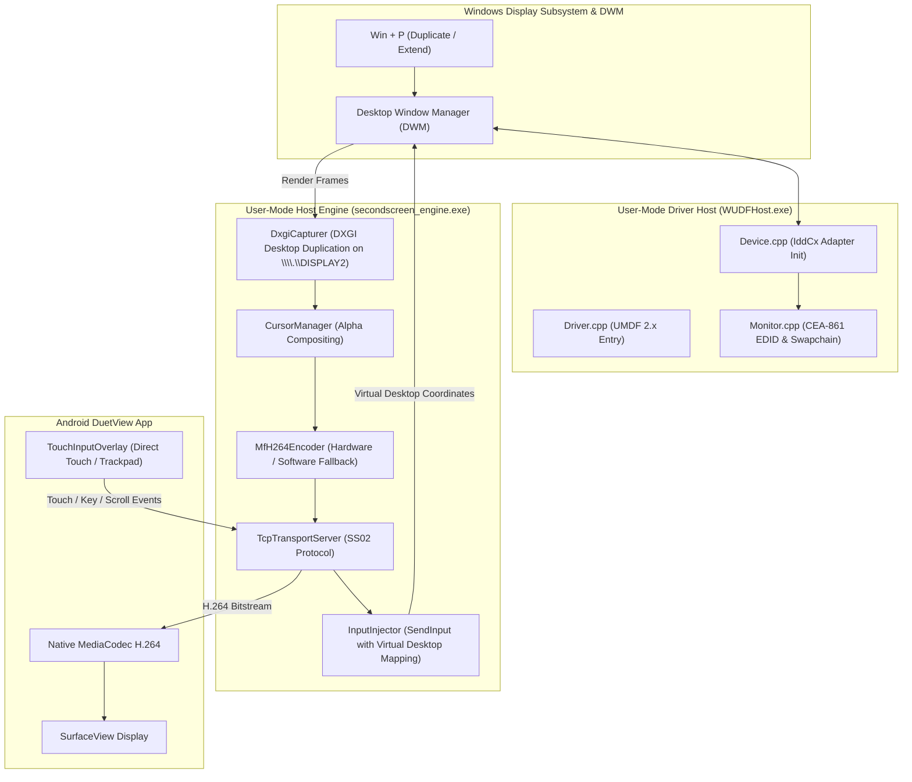

# DuetView PC — Bundled Virtual Display Driver & Installation Guide

## 1. Architectural Overview

DuetView implements a true independent virtual display using Microsoft's **Indirect Display Driver (IddCx)** framework on top of **UMDF 2.25 (User-Mode Driver Framework)**.



### Key Architectural Strengths
1. **True Extended Desktop**: Windows treats the virtual monitor as a real hardware display (`\\.\DISPLAY2`). Users can press `Win + P`, select **Extend**, and drag application windows onto the virtual display.
2. **Zero BSOD Risk**: The driver runs in user space inside `WUDFHost.exe` under `NT AUTHORITY\LocalService`. An unhandled exception or crash terminates the host process without causing a Blue Screen of Death (BSOD) or corrupting kernel memory.
3. **Decoupled Fallback**: Desktop Mirroring is built into the engine without needing any driver. If the driver is not installed, Desktop Mirroring is immediately available.

---

## 2. Bundled Installation Architecture

Ordinary end users do **not** need Visual Studio, the Windows Driver Kit, or development scripts. The driver package is bundled directly inside the DuetView PC installation.

### 2.1 Installed Directory Layout
When installed via `DuetViewPC-Setup.exe` (or extracted from the portable package), DuetView PC installs to `%LocalAppData%\Programs\DuetView\`:

```text
%LocalAppData%\Programs\DuetView\
├── SecondScreenApp.exe         # Desktop GUI Host Application
├── secondscreen_engine.exe     # Native H.264 Streaming Engine
├── duetview.ico                # Official Application Icon
├── uninstall.bat               # Clean Uninstaller Script
└── driver\                     # Bundled Virtual Display Driver Package
    ├── SecondScreenIdd.inf     # PnP Setup Information File
    ├── install_driver.bat      # Elevated Deployment Script
    ├── uninstall_driver.bat    # Safe Teardown Script
    ├── SecondScreenIdd.dll     # Compiled Driver Binary (when built with WDK)
    ├── SecondScreenIdd.cat     # Security Catalog File (when signed)
    └── SecondScreenIdd.cer     # Test Certificate (for development builds)
```

### 2.2 Application-Relative Path Resolution
The installed application locates its bundled driver via `DriverManager::FindDriverInfPath()`:
1. `<AppDir>\driver\SecondScreenIdd.inf` (Preferred bundled directory)
2. `<AppDir>\SecondScreenIdd.inf` (Flat portable layout)
3. Source tree fallbacks (for development environments)

The application **never** depends on developer source paths (`D:\Second Display\native\...`).

---

## 3. First-Launch Driver Setup & State Management

When DuetView PC launches, it queries the Windows PnP device tree via `SetupDiGetClassDevsW` and Configuration Manager `CM_Get_DevNode_Status`:

1. **State: Ready**: Driver is active and the virtual monitor is active. The application continues smoothly without prompting.
2. **State: InstalledButMonitorNotAvailable**: Driver is running, but Windows display output is not extended. The UI reminds the user to press `Win + P` and select **Extend**.
3. **State: RestartRequired**: The driver was deployed, but Windows requires a reboot before `WUDFHost.exe` loads the device. A clear dialog explains this requirement and notes that Desktop Mirroring is available immediately.
4. **State: InstalledButNotOperational**: Driver is present but reported a device error (e.g. Code 43). A diagnostic dialog offers an automated repair/reinstall action.
5. **State: NotInstalled / InstallationFailed**:
   - On first launch, a welcome dialog offers to install the bundled driver for Extended Display mode or continue with Desktop Mirroring.
   - The user's choice is saved in `HKCU\Software\DuetView\Settings\FirstLaunchPromptSeen` to avoid repeatedly nagging the user.
   - The user can trigger installation at any time via the **Install Virtual Display Driver** button.

---

## 4. Supported Elevated Installation (UAC)

Display drivers must be registered in the Windows Driver Store (`%SystemRoot%\System32\DriverStore\FileRepository`). Windows strictly requires administrative privileges for this operation:

1. **User Notification**: Before elevation, DuetView PC notifies the user that Windows will request administrator approval.
2. **Supported Elevation**: Elevation is requested via `ShellExecuteExW` with the `runas` verb targeting `pnputil.exe`.
3. **PnPUtil Execution**:
   ```cmd
   pnputil.exe /add-driver "<AppDir>\driver\SecondScreenIdd.inf" /install
   ```
4. **Cancellation Handling**: If the user declines the UAC prompt (error `ERROR_CANCELLED`), the installation is canceled gracefully without corrupting the app or system. Desktop Mirroring remains 100% active.
5. **Exit Code Validation**:
   - `0`: Success — driver registered and started.
   - `3010`: Reboot required before device becomes operational.
   - `2`: Missing driver files or dependencies.

---

## 5. Driver Signing Requirements

Windows enforces strict code signing on all display drivers:

### 5.1 Production Distribution
For public distribution to ordinary end users without test mode:
1. **Hardware Partner Center (WHQL / Attestation Signing)**:
   - The driver package (`SecondScreenIdd.dll`, `SecondScreenIdd.inf`) is submitted to the Microsoft Windows Hardware Developer Center.
   - Submitted using an **Extended Validation (EV) Code Signing Certificate**.
   - Microsoft returns a WHQL-signed catalog file (`SecondScreenIdd.cat`).
   - The driver installs seamlessly on all Windows 10/11 machines with Secure Boot enabled, requiring zero user-side security overrides.

### 5.2 Development & Internal Testing
For development builds compiled with Visual Studio 2022 + WDK 11:
1. Enable Windows Test-Signing Mode:
   ```cmd
   bcdedit /set testsigning on
   ```
2. Reboot the PC.
3. Install the test certificate:
   ```cmd
   certmgr.exe /add native\virtual_display_driver\x64\Release\SecondScreenIdd.cer /s /r localMachine root
   certmgr.exe /add native\virtual_display_driver\x64\Release\SecondScreenIdd.cer /s /r localMachine trustedpublisher
   ```
4. DuetView PC's automated installer will now deploy the driver package cleanly.
