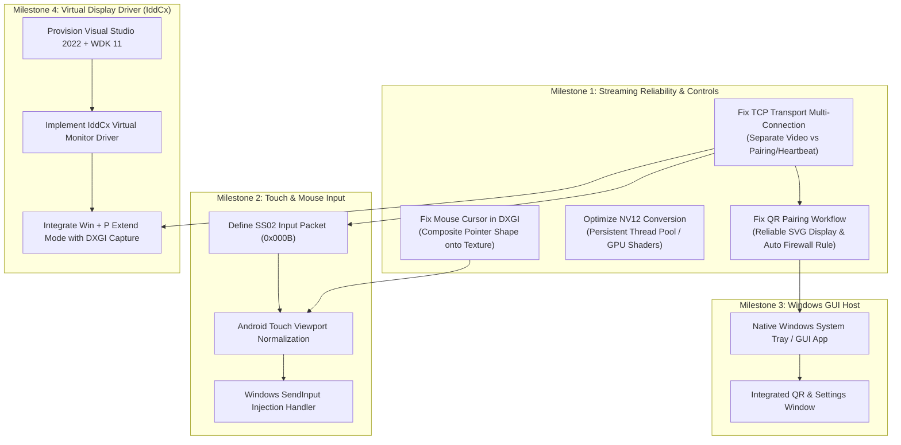

# SecondScreen — Comprehensive Implementation Audit & Technical Status Report

**Date:** October 30, 2026  
**Auditor:** Antigravity AI Engineering  
**Scope:** Windows Native Engine, Android Client, Networking/Protocols, Display Driver Architecture, Input Subsystem, and Hardware Compatibility.

---

## 1. Executive Summary

SecondScreen is an open-source system designed to turn an Android tablet or phone into a genuine extended desktop monitor for a Windows PC over Wi-Fi or USB. 

An exhaustive codebase inspection of the active repository (`d:\Second Display`) reveals that while **high-performance screen streaming, SS02 framing, and Android MediaCodec decoding are structurally implemented and unit-tested**, critical subsystems required for a usable end-user product are **either missing, operating in fallback/mirror mode, or failing in physical runtime**:

1. **Virtual Display Driver (IddCx):** Completely **missing**. `native/virtual_display_driver` is an empty directory. The application mirrors the primary screen because DXGI Desktop Duplication can only capture displays that Windows already manages. Without a software Indirect Display Driver, Windows cannot extend the desktop (`Win + P` Extend is impossible).
2. **Mouse Cursor Visibility:** **Broken**. `dxgi_capturer.cpp` copies the desktop render target directly without compositing the hardware mouse cursor (`DXGI_OUTDUPL_FRAME_INFO.PointerPosition` is unhandled).
3. **Touch Input:** **Missing**. There is zero touch coordinate capture on Android, zero input packet definitions in the SS02 protocol, and zero `SendInput` injection on Windows.
4. **QR Pairing:** **Partially Implemented / Runtime Failures**. QR generation works, but ASCII/ANSI terminal blocks distort on non-square fonts, `secondscreen_pair.html` is an unintegrated static file written to the build folder, Windows Firewall blocks incoming TCP connections by default, and the Windows TCP transport server conflates pairing/health sockets with active video stream sessions.
5. **Windows Host Application:** **CLI Console Only**. The host runs as a console binary operated via PowerShell flags and stdin characters (`[q]`, `[r]`, `[s]`) rather than a native Windows GUI or system tray utility.
6. **Hardware Encoding Performance:** **Unstable Fallback**. The encoder falls back to CPU software encoding because Intel Quick Sync MFT is asynchronous (`MF_TRANSFORM_ASYNC=1`). Software NV12 color conversion spawns and joins 4 threads per frame, leading to CPU thrashing and frame drops.

---

## 2. Feature Status Matrix

| Subsystem / Feature | Status | Primary Code Files & Key Symbols | Findings & Root Cause |
|---|---|---|---|
| **Virtual Extended Display (IddCx)** | **Missing / Documented Only** | `native/virtual_display_driver/`<br>`docs/virtual-display-driver-roadmap.md` | Directory is empty. No driver code, INF file, or build system exists. Development machine lacks Visual Studio MSVC & Windows Driver Kit (WDK) 11. |
| **Windows Desktop Capture** | **Partially Implemented** | `native/windows_engine/src/capture/dxgi_capturer.cpp`<br>`DxgiCapturer::Impl::AcquireNextFrame` | Captures output 0 (`\\.\DISPLAY1`) via DXGI Desktop Duplication. Mirrored capture works, but cannot extend without a virtual display. |
| **Mouse Cursor Rendering** | **Broken** | `native/windows_engine/src/capture/dxgi_capturer.cpp`<br>`AcquireNextFrame`, `DXGI_OUTDUPL_FRAME_INFO` | Hardware cursor is not composited onto the captured texture. `PointerPosition` and `GetFramePointerShape` are ignored. |
| **Touch / Mouse Input Control** | **Missing** | `apps/android_app/lib/screens/streaming_screen.dart`<br>`native/windows_engine/src/main.cpp` | `streaming_screen.dart` uses `GestureDetector` only to show/hide the app bar. No input packets in SS02; no `SendInput` API on Windows. |
| **Media Foundation H.264 Encoder** | **Partially Implemented** | `native/windows_engine/src/encoder/mf_h264_encoder.cpp`<br>`MfH264Encoder::Impl::Initialize` | Intel QSV rejected due to asynchronous MFT requirement (`MF_TRANSFORM_ASYNC=1`). Falls back to software `CLSID_MSH264Enc`. `ConvertBgraToNv12` spawns/joins 4 threads per frame. |
| **SS02 TCP Transport** | **Partially Implemented** | `native/windows_engine/src/transport/tcp_transport_server.cpp`<br>`TcpTransportServer::AcceptLoop` | Supports 24-byte SS02 framing. However, server assumes only a single client socket and immediately starts video streaming upon any connection (even pairing/heartbeat). |
| **Windows QR Generation** | **Implemented & Verified** | `native/windows_engine/src/pairing/pairing_manager.cpp`<br>`qrcodegen.cpp` | Nayuki QR engine generates valid Schema v1 JSON payloads with UUID and 5-min tokens. 17 C++ unit tests pass. |
| **Windows QR Display** | **Partially Implemented** | `native/windows_engine/src/pairing/pairing_manager.cpp`<br>`PrintConsoleQrCode`, `ExportPairingHtml` | Terminal ANSI block QR code distorts due to console font aspect ratios. `secondscreen_pair.html` is generated in `build/` rather than a standard user-facing location. |
| **Windows Pairing Handshake** | **Partially Implemented** | `native/windows_engine/src/main.cpp`<br>`onClientMessage`, `PacketType::PairRequest` | Windows verifies token and replies with `PairResponse` (0x000A), but active video streaming is started simultaneously, causing socket contention. |
| **Android QR Scanner** | **Implemented & Verified** | `apps/android_app/lib/screens/qr_scanner_screen.dart`<br>`mobile_scanner: ^7.4.2` | Camera scanner with torch toggle, reticle overlay, and manual paste fallback. |
| **Saved-PC Management** | **Implemented & Verified** | `apps/android_app/lib/services/saved_pc_storage.dart`<br>`SavedPcStorage` | `SharedPreferences` persistence, deduplication by stable UUID, IP address merging, and rename preservation. 5 unit tests pass. |
| **Background Health Checks** | **Implemented & Verified** | `apps/android_app/lib/services/pc_health_service.dart`<br>`PcHealthService` | 5-second lightweight `PACKET_TYPE_HEARTBEAT` (0x0004); pauses on app backgrounding; marks offline after 3 missed checks. |
| **Android MediaCodec Decoder** | **Implemented & Verified** | `apps/android_app/android/.../H264Decoder.kt`<br>`SecondScreenNativeBridge.kt` | MediaCodec configured in low-latency mode (`KEY_LOW_LATENCY = 1`). Extracts Annex B SPS/PPS into `csd-0`/`csd-1`. |
| **Android Native SurfaceView** | **Implemented & Verified** | `apps/android_app/android/.../VideoSurfacePlatformView.kt`<br>`h264_surface_view.dart` | Embedded native `SurfaceView` via Flutter `AndroidView` for zero-copy GPU video rendering. |
| **Phase 3 SS01 JPEG Fallback** | **Implemented & Verified** | `apps/android_app/lib/services/connection_service.dart` | Automatic fallback to SS01 JPEG when H.264 codec is unavailable. |
| **Windows Interactive GUI** | **Missing** | `native/windows_engine/src/main.cpp` | Operates solely via PowerShell CLI arguments and terminal keystrokes. |

---

## 3. Detailed Investigation of Current Problems

### 3.1 Problem 1 & 8: Display Mirroring Instead of Extended Monitor (`Win + P`)

#### Root Cause
In `native/windows_engine/src/capture/dxgi_capturer.cpp`:
```cpp
for (UINT oIdx = 0; curAdapter->EnumOutputs(oIdx, &curOutput) != DXGI_ERROR_NOT_FOUND; ++oIdx) {
    DXGI_OUTPUT_DESC oDesc;
    curOutput->GetDesc(&oDesc);
    if (oDesc.AttachedToDesktop) {
        if (currentGlobalOutputIndex == config.monitorIndex) { // config.monitorIndex == 0
            adapter = curAdapter;
            deviceName = oDesc.DeviceName;
            ...
```
- DXGI Desktop Duplication (`IDXGIOutputDuplication`) is a **capture API**, not a **display driver**. It can only duplicate pixels that Windows has already allocated to an active monitor.
- Because no physical secondary monitor is attached and no software virtual monitor driver exists, Windows only has one display (`\\.\DISPLAY1`).
- Pressing `Win + P` shows "Duplicate" and "Extend", but selecting "Extend" has no effect because Windows detects only one display output.

#### Solution Path
To support true extended desktop mode:
1. An **Indirect Display Driver (IddCx / UMDF 2.x)** must be installed on Windows.
2. The driver creates a virtual monitor device that Windows PnP and DWM recognize.
3. Windows Display Settings automatically enables "Extend these displays".
4. The SecondScreen capture engine targets `config.monitorIndex = 1` (`\\.\DISPLAY2`).

---

### 3.2 Problem 2: Mouse Cursor Not Visible on the Android Stream

#### Root Cause
In `native/windows_engine/src/capture/dxgi_capturer.cpp`:
```cpp
HRESULT hr = duplication->AcquireNextFrame(timeoutMs, &frameInfo, &desktopResource);
...
context->CopyResource(retainedTexture.Get(), acquiredTexture.Get());
duplication->ReleaseFrame();
```
- Hardware mouse cursors are rendered by the GPU display scanout hardware, not into the desktop swapchain.
- `AcquireNextFrame` populates `frameInfo.PointerPosition` and `frameInfo.PointerShapeBufferSize`.
- Currently, `frameInfo` is ignored, and the pointer shape is never queried via `duplication->GetFramePointerShape()`.
- Consequently, the captured texture contains the desktop background and windows, but **zero mouse cursor pixels**.

#### Solution Path
1. Inspect `frameInfo.PointerPosition.Visible`.
2. When visible, obtain the pointer shape buffer via `duplication->GetFramePointerShape()`.
3. Composite the pointer shape onto `retainedTexture` using D3D11 shader blitting or GDI alpha-blending before handing the frame to the encoder.

---

### 3.3 Problem 3: Touch Interactions Do Not Control Windows

#### Root Cause
1. **Android Layer (`streaming_screen.dart` & `VideoSurfacePlatformView.kt`):**
   - In `streaming_screen.dart`:
     ```dart
     GestureDetector(
       behavior: HitTestBehavior.opaque,
       onTap: _toggleOverlay,
       child: ...
     )
     ```
     Touch events are consumed exclusively to toggle the navigation overlay.
   - In `VideoSurfacePlatformView.kt`, the native `SurfaceView` does not implement `View.OnTouchListener`.
2. **Protocol Layer (`shared/protocol/README.md` & `protocol_constants.hpp`):**
   - There are no packet types defined for mouse or touch events. The opcodes jump from `0x0008` (ReceiverReport) to `0x0009` (PairRequest).
3. **Windows Host Layer (`native/windows_engine/src/main.cpp`):**
   - The Windows engine has no input injection logic. There are no calls to the Win32 `SendInput` API or `SetCursorPos` / `mouse_event`.

#### Solution Path
1. Define SS02 packet types:
   - `PACKET_TYPE_TOUCH_EVENT` (`0x000B`): pointer ID, action (down, move, up), normalized X/Y float (0.0 to 1.0), and timestamp.
2. In Android, wrap the video viewport in a custom touch listener that calculates normalized display coordinates and sends `PACKET_TYPE_TOUCH_EVENT` upstream over the TCP socket.
3. In Windows, map incoming normalized coordinates to the virtual display's pixel coordinates and invoke the Win32 `SendInput` API with `INPUT_MOUSE` / `MOUSEEVENTF_ABSOLUTE`.

---

### 3.4 Problem 4 & 6: QR Pairing Failures & Role of `secondscreen_pair.html`

#### Analysis of `secondscreen_pair.html`
- **What it is:** A static, standalone HTML page containing an embedded SVG QR code and PC connection details, generated by `PairingManager::ExportPairingHtml()`.
- **Current Role:** A prototype/export artifact, **not an interactive web app or active server**. It has no WebSocket or HTTP listener to communicate with the engine.
- **Location Issue:** It is exported into the process's working directory (`native/windows_engine/build/secondscreen_pair.html`). Users looking in the project root directory cannot find it unless the executable was launched from the root.

#### Why QR Pairing Fails in Practice
1. **Console QR Unreadability:** Terminal ANSI block characters (`██` / `  `) are rendered with rectangular aspect ratios and line-spacing gaps in standard PowerShell windows. Phone cameras and `MobileScanner` fail to recognize distorted modules.
2. **Socket Conflation in `TcpTransportServer`:**
   - In `native/windows_engine/src/transport/tcp_transport_server.cpp`:
     ```cpp
     if (clientSocket_ != INVALID_SOCKET) {
         closesocket(clientSocket_); // Closes previous client!
     }
     clientSocket_ = newClient;
     isClientConnected_.store(true);
     if (clientConnectedCallback_) clientConnectedCallback_();
     ```
   - When Android connects on port 52025 to perform the pairing handshake, Windows treats it as a video client and immediately starts streaming H.264 frames to it!
   - As soon as pairing finishes, Android closes the socket. Windows logs `[INFO] Client disconnected`, causing state thrashing.
   - If a background health check (heartbeat) arrives, it drops any active video stream socket!
3. **Windows Firewall:** Port 52025 is blocked for inbound connections on Windows by default unless an explicit firewall rule has been added.

---

### 3.5 Problem 5: Host Operates Through PowerShell Rather Than a Dedicated App

#### Current Reality
- The Windows engine is a native Win32 console executable built with MinGW GCC and CMake.
- There is no GUI framework integrated (no Win32 Window, WPF, WinUI 3, Qt, or Flutter Desktop).
- Startup requires command-line arguments: `--show-qr`, `--name "PC"`, `--port 52025`.
- Control requires stdin keystrokes: `[q]`, `[r]`, `[s]`.

#### Recommendation
A lightweight, modern Windows GUI or System Tray application should host the native streaming engine. Options:
1. **Flutter Desktop (Windows):** Reuses existing Flutter widgets and design language; controls the native engine via C++ FFI or standard process pipe.
2. **Win32 / C++ System Tray App:** Ultra-lightweight native C++ app with a taskbar tray icon, context menu ("Show QR", "Settings", "Connected Clients"), and native dialogs.

---

### 3.6 Problem 7: Unstable Streaming Performance

#### Root Causes
1. **CPU Software Encoder Fallback:**
   - In `mf_h264_encoder.cpp`, Intel Quick Sync Video MFT is discarded because `MF_TRANSFORM_ASYNC` is reported as true.
   - The engine falls back to `CLSID_MSH264Enc` (Microsoft Software H.264 Encoder).
2. **Thread Churn in Color Conversion:**
   - In `ConvertBgraToNv12`, the engine spawns and joins 4 `std::thread`s on **every single frame**:
     ```cpp
     for (unsigned int i = 0; i < numThreads; ++i) {
         workers.emplace_back(ConvertBgraToNv12Slice, ...);
     }
     for (auto& w : workers) w.join();
     ```
     At 30–60 FPS, this creates 120–240 thread creations/destructions per second, causing severe scheduler thrashing and CPU latency spikes.
3. **CPU Readback from GPU:**
   - The software encoder forces DXGI textures to be copied from GPU VRAM to a CPU staging texture (`stagingContext->CopyResource`) and mapped across the PCIe bus (`stagingContext->Map`) on every frame.

---

## 4. Reusable Components

The following components are well-structured, production-ready, and should be **strictly preserved**:

1. **Protocol Header & Framing (`protocol_header.hpp`, `protocol_header.cpp`):**
   Robust 24-byte binary framing (`SS02`, Big-Endian network order, magic validation, sequence tracking).
2. **Android MediaCodec Pipeline (`H264Decoder.kt`, `H264ConfigParser.kt`):**
   Correctly handles Annex B NAL parsing, parameter sets (`csd-0`, `csd-1`), format changes, and surface binding.
3. **Android Platform View Rendering (`VideoSurfacePlatformView.kt`, `h264_surface_view.dart`):**
   Hardware-accelerated native `SurfaceView` presentation embedded seamlessly in Flutter.
4. **Android Packet Accumulator (`frame_accumulator.dart`):**
   Full multi-chunk TCP reconstruction, buffer compaction, and packet extraction. Unit-tested across edge cases.
5. **Saved-PC Storage & Health Monitoring (`saved_pc_storage.dart`, `pc_health_service.dart`):**
   Deduplication, rename persistence, and lifecycle-aware periodic polling.
6. **Adaptive AIMD Controller (`adaptive_controller.cpp`):**
   Multiplicative decrease and additive increase responding to network RTT and receiver reports.

---

## 5. Missing Components

1. **Windows Indirect Display Driver (IddCx / UMDF 2.x):**
   Required to create `\\.\DISPLAY2` so Windows can extend the desktop.
2. **Mouse Cursor Compositing in DXGI Capturer:**
   Required to composite hardware mouse cursor shape and coordinates onto the captured video frame.
3. **Upstream Touch & Mouse Input Pipeline:**
   - SS02 packet definition for input (`PACKET_TYPE_INPUT_EVENT = 0x000B`).
   - Android touch gesture recognizer & coordinate normalizer.
   - Windows input injector using `SendInput`.
4. **Multiplexed / Differentiated TCP Transport:**
   Separation between control connections (pairing handshake, health pings) and active streaming connections so that health checks do not interrupt video streaming.
5. **Dedicated Windows Host GUI / Tray Application:**
   Native graphical interface replacing command-line PowerShell operation.

---

## 6. Dependency Graph Between Features



---

## 7. Phased Implementation Plan

### Phase 1: Engine Stabilization, Cursor Visibility, & Pairing Fixes (Immediate)
- **Goal:** Ensure mouse cursor is visible, eliminate thread churn in software encoding, separate control/video connections, and make QR pairing 100% reliable.
- **Tasks:**
  1. Update `dxgi_capturer.cpp` to composite pointer shape via `GetFramePointerShape()`.
  2. Refactor `tcp_transport_server.cpp` to handle control packets (`PairRequest`, `Heartbeat`) without closing or corrupting active video streaming sessions.
  3. Replace per-frame `std::thread` spawning in `mf_h264_encoder.cpp` with a persistent worker thread pool or single-threaded SIMD conversion.
  4. Output `secondscreen_pair.html` to a reliable user path and provide a CLI flag to launch it automatically in the default browser.

### Phase 2: Touch & Remote Input Injection
- **Goal:** Allow tapping and dragging on Android to control the Windows PC.
- **Tasks:**
  1. Add `PACKET_TYPE_INPUT_EVENT = 0x000B` to SS02 protocol.
  2. Implement `TouchInputHandler` in Android to capture pointer coordinates, normalize them to `0.0..1.0`, and stream them to Windows.
  3. Implement `InputInjector` in Windows using Win32 `SendInput` to control cursor position and click/drag events.

### Phase 3: Dedicated Windows GUI Application
- **Goal:** Eliminate PowerShell console requirement; provide an intuitive graphical application.
- **Tasks:**
  1. Implement a Windows GUI (or system tray utility) displaying active status, connected devices, and one-click pairing QR code.
  2. Add automatic Windows Firewall exception detection and prompt.

### Phase 4: Windows Indirect Display Driver (IddCx)
- **Goal:** True extended display monitor (`Win + P` Extend).
- **Tasks:**
  1. Install Visual Studio 2022 Community and WDK 11.
  2. Build a UMDF 2.x IddCx virtual display driver based on Microsoft's canonical IndirectDisplay sample.
  3. Sign and install the driver package with test-signing enabled.
  4. Configure DXGI Desktop Duplication to capture `\\.\DISPLAY2`.

---

## 8. Build, Test, and Hardware Requirements

1. **Current Environment Capabilities:**
   - Windows 11 Build `10.0.26200.9711` with CMake, Ninja, MinGW GCC, and Flutter SDK 3.x.
   - Able to build `secondscreen_engine.exe` and `app-debug.apk`.
   - Unit test suites pass (17/17 C++ tests, 53/53 Flutter tests).
2. **Missing Prerequisites for Phase 4 (Driver):**
   - **Visual Studio 2022** with C++ Desktop Workload.
   - **Windows 11 WDK (Build 10.0.26100.x)** matching Windows SDK.
   - Test-signing mode (`bcdedit /set testsigning on`) enabled for loading custom unsigned drivers.
3. **Physical Hardware Testing Requirements:**
   - Physical Android device connected over USB with USB debugging enabled.
   - 5 GHz Wi-Fi router on the same subnet without Client/AP Isolation.
   - Windows Firewall rule permitting TCP port `52025`.

---

## 9. Recommended First Implementation Task & Acceptance Criteria

### Recommended Task: **Milestone 1A — TCP Transport Multiplexing & Mouse Cursor Compositing**

Before touching the driver or input injection, the core video pipeline and connection handling must be stabilized so that pairing, health checks, and video streaming can coexist reliably, and the mouse cursor is visible on the video stream.

### Exact Acceptance Criteria:

1. **Mouse Cursor Compositing:**
   - In `native/windows_engine/src/capture/dxgi_capturer.cpp`, `AcquireNextFrame` queries `frameInfo.PointerPosition` and `duplication->GetFramePointerShape()`.
   - When the cursor is moved, the cursor shape is composited onto the captured desktop texture.
   - The mouse cursor is visibly drawn on the Android client stream.

2. **TCP Transport Multi-Connection Separation:**
   - In `native/windows_engine/src/transport/tcp_transport_server.cpp`, incoming connections for `PairRequest` or `Heartbeat` do not terminate an active streaming client's socket.
   - Health check probes (`PACKET_TYPE_HEARTBEAT`) receive `PACKET_TYPE_HEARTBEAT_ACK` and close cleanly without triggering `clientConnectedCallback_()` or starting video capture.
   - Video streaming only activates upon an explicit stream initiation handshake or client stream socket.

3. **Software Color Conversion Optimization:**
   - Spawning and joining `std::thread`s on every frame in `ConvertBgraToNv12` is eliminated.
   - Replaced by a persistent worker thread pool or single-threaded optimized conversion, eliminating thread creation thrashing.

4. **Pairing Artifact Usability:**
   - Running `secondscreen_engine.exe --show-qr` automatically exports `secondscreen_pair.html` to both the working directory and project root, and launches the default browser (or prints a clear URL) so the phone can scan the clean SVG QR code immediately without relying on distorted terminal text.

